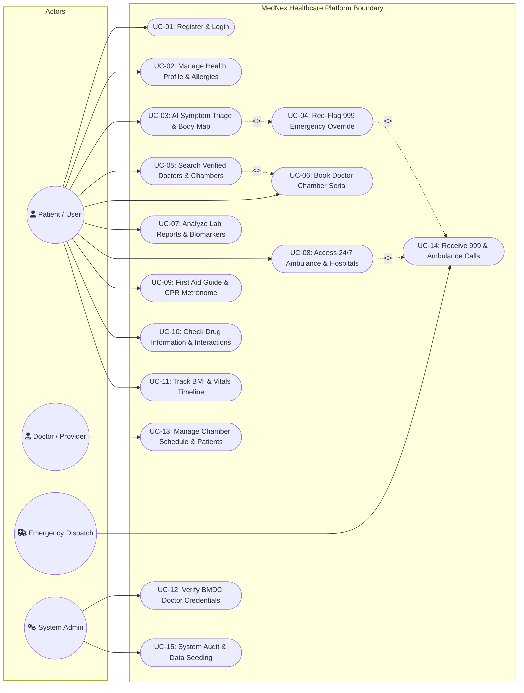
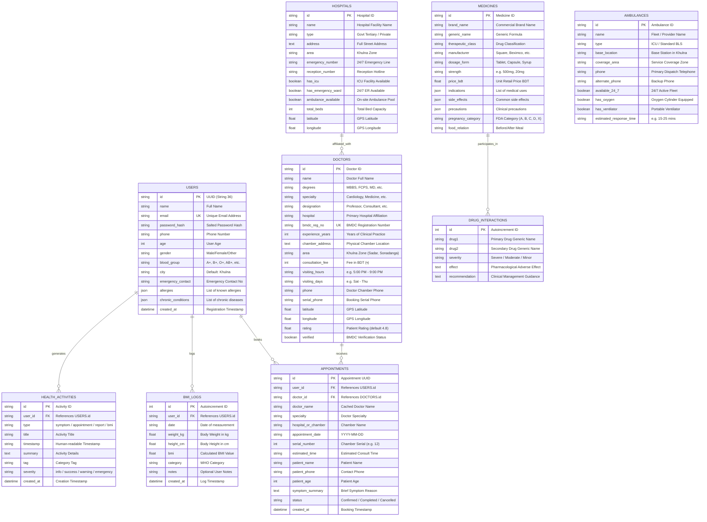
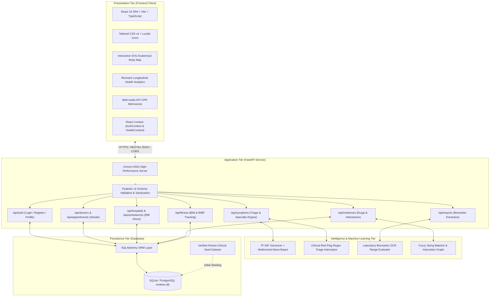

# SOFTWARE REQUIREMENTS SPECIFICATION (SRS)
## MedNex – AI-Powered Healthcare Assistance & Clinical Triage Platform

**Course Code:** CSE4104  
**Document Version:** 1.0.0  
**Status:** Approved for System Design & Development Phase  
**Release Date:** November 2026  
**Target Market:** Bangladesh (Primary Deployment Region: Khulna Division)

---

## TABLE OF CONTENTS
1. [Introduction](#1-introduction)
   - 1.1 Project Title
   - 1.2 Project Overview
   - 1.3 Problem Statement
   - 1.4 Objectives
   - 1.5 Scope of the Project
2. [Functional Requirements (FR)](#2-functional-requirements)
   - 2.1 User Authentication & Profile Management
   - 2.2 AI Symptom Checker & Clinical Triage
   - 2.3 Verified Doctor Directory & Chamber Serial Booking
   - 2.4 Medical Laboratory Report Analyzer (OCR & Biomarkers)
   - 2.5 Emergency Ambulance & Hospital Locator (999 Hotline)
   - 2.6 Clinical First Aid Assistant & Interactive CPR
   - 2.7 AI Medicine Directory & Drug Interaction Checker
   - 2.8 Patient Vitals & Health History Tracking
3. [Non-Functional Requirements (NFR)](#3-non-functional-requirements)
   - 3.1 Performance & Latency
   - 3.2 Responsiveness & Usability
   - 3.3 Security & Medical Data Privacy
   - 3.4 Reliability, Fault Tolerance & Clinical Safety
   - 3.5 Scalability & Maintainability
4. [User Roles & Responsibilities](#4-user-roles--responsibilities)
   - 4.1 Patient / General User
   - 4.2 Doctor / Healthcare Provider
   - 4.3 Emergency Ambulance Provider / Dispatcher
   - 4.4 System Administrator
5. [Use Cases & System Interactions](#5-use-cases--system-interactions)
   - 5.1 Use Case Summary Table
   - 5.2 Detailed Use Case Specifications (UC-01 to UC-07)
6. [Initial System Diagrams](#6-initial-system-diagrams)
   - 6.1 Use Case Diagram (UML)
   - 6.2 Entity Relationship Diagram (ERD) & DBDiagram Code
   - 6.3 System Architecture Diagram
7. [Project GitHub & Submission Standards](#7-project-github--submission-standards)
   - 7.1 Official File Naming Conventions
   - 7.2 Repository Organization & README Standards

---

## 1. INTRODUCTION

### 1.1 Project Title
**MedNex – AI-Powered Healthcare Assistance & Clinical Triage Platform**

### 1.2 Project Overview
**MedNex** is an intelligent, ethical, full-stack healthcare companion platform engineered to bridge critical accessibility, navigation, and medical triage gaps across Bangladesh, with localized deployment centered on the **Khulna** metropolitan and divisional area. 

MedNex equips citizens and patients with a multi-layered healthcare support system:
1. An NLP-driven symptom evaluation engine that classifies clinical urgency and maps conditions to appropriate medical specialties.
2. A zero-hallucination registry of verified Bangladesh Medical and Dental Council (BMDC) registered doctors, regional hospitals, and emergency chambers in Khulna with instant serial booking.
3. An Optical Character Recognition (OCR) and biomarker parsing engine that translates dense diagnostic laboratory reports into plain-language clinical insights and doctor consultation checklists.
4. An interactive first-aid guide with acoustic CPR pacing and verified clinical protocols.
5. Direct 24/7 emergency dispatch connectivity linking users to the national **999** helpline and certified regional ambulance pools.
6. A pharmaceutical reference and multi-drug interaction safety checker tailored to Bangladeshi commercial medicines.
7. Longitudinal anthropometric and BMI vitals monitoring with exportable patient history.

### 1.3 Problem Statement
The healthcare delivery landscape in developing regions such as Bangladesh suffers from acute systemic bottlenecks:
- **Low Health Literacy & Delayed Emergency Response:** Patients frequently ignore early warning signs of acute cardiovascular, neurological, or respiratory emergencies, or attempt inappropriate self-medication during critical intervention windows.
- **Proliferation of Unverified Practitioners & Chamber Confusion:** Patients struggle to find verified medical specialists, often falling prey to unqualified practitioners or experiencing chaotic booking procedures at private chambers in divisional centers like Khulna.
- **Diagnostic Report Misinterpretation:** Routine pathology reports (e.g., Complete Blood Count, Lipid Profile, Liver Function Tests) are delivered in complex clinical terminology with numerical ranges that patients cannot interpret, causing unnecessary anxiety or neglected chronic illnesses.
- **Critical Gaps in Emergency First Aid:** When accidents, burns, choking, or snakebites occur, bystanders frequently resort to unscientific folk remedies rather than medically recognized protocols.
- **Fragmented Emergency Transport:** Securing an equipped ICU or Basic Life Support (BLS) ambulance during odd hours in Khulna typically relies on word-of-mouth with unpredictable response times and opaque pricing.
- **Polypharmacy & Drug Interactions:** Concurrent usage of over-the-counter and prescription drugs without cross-checking adverse contraindications poses severe health risks.

### 1.4 Objectives
The primary engineering and clinical objectives of MedNex are:
- **Obj-01:** Build an intelligent, conversational, and visual symptom triage system using Machine Learning (TF-IDF + Naive Bayes) and deterministic clinical red-flag rules that flags emergencies within 500 ms.
- **Obj-02:** Establish an authenticated, zero-hallucination directory of BMDC-registered physicians and hospitals in Khulna, enabling automated chamber serial number reservation.
- **Obj-03:** Implement automated diagnostic report parsing using OCR and regular expression heuristics to extract clinical biomarkers, compare them against standard biological reference intervals, and generate patient-friendly summaries.
- **Obj-04:** Provide offline-capable, step-by-step first-aid protocols, interactive DOs/DON'Ts, and an acoustic CPR metronome (100–120 BPM) for emergency bystanders.
- **Obj-05:** Deliver single-tap emergency dispatch connectivity with the national 999 hotline and direct telephonic routing to verified 24/7 ICU/Oxygen ambulance fleets in Khulna.
- **Obj-06:** Implement a pharmaceutical safety index covering Bangladesh-marketed medicines (Square, Beximco, Incepta, etc.) to detect acute drug-drug contraindications.
- **Obj-07:** Provide longitudinal health tracking including adult Body Mass Index (BMI) calculations, WHO classifications, and downloadable medical history timelines.

### 1.5 Scope of the Project
#### In-Scope:
- User registration, authentication, medical profile persistence (blood group, allergies, chronic conditions).
- Free-text and visual interactive SVG body map symptom intake.
- Natural Language Processing (NLP) symptom classification and specialty routing.
- Real-time red-flag emergency detection and 999 dialing prompts.
- Khulna medical registry: BMDC doctor directory, chambers, fees, visiting days/hours, GPS location mapping, and chamber appointment serial booking.
- Laboratory report OCR text ingestion, biomarker reference range comparison, abnormal value flagging, and doctor discussion question generation.
- Emergency ambulance registry with equipment breakdown (ICU, ventilator, oxygen) and direct dialing.
- Step-by-step emergency first aid procedures with DOs/DON'Ts and CPR metronome.
- Pharmaceutical database search and multi-drug interaction risk evaluator.
- BMI calculator, WHO category scoring, longitudinal weight chart (Recharts), and health activity export.

#### Out-of-Scope:
- Autonomous clinical diagnosis or issuing prescription medications without a certified doctor.
- Direct digital financial payment processing (chamber consultation fees are settled directly at chamber reception).
- Telemedicine video streaming consultations (referrals and bookings are handled).
- Invasive medical equipment telemetry or direct hospital Electronic Health Record (EHR) database integration.

---

## 2. FUNCTIONAL REQUIREMENTS

Functional requirements detail the specific operations, services, and behaviors that the MedNex system must execute.

### 2.1 User Authentication & Profile Management
- **FR-01:** The system shall allow new users to register an account by providing Full Name, Email Address, Phone Number, Age, Gender, Blood Group, and Password.
- **FR-02:** The system shall require user consent to the Medical Safety Disclaimer during account registration.
- **FR-03:** The system shall authenticate returning users using their registered email and encrypted password.
- **FR-04:** The system shall allow users to log out and invalidate active session tokens.
- **FR-05:** The system shall provide a password reset workflow via registered email verification.
- **FR-06:** The system shall allow users to manage personal clinical metadata including blood group, known drug/food allergies, chronic health conditions, and emergency contact numbers.

### 2.2 AI Symptom Checker & Clinical Triage
- **FR-07:** The system shall allow users to input symptoms via free-text natural language queries.
- **FR-08:** The system shall allow users to select affected body regions via an interactive visual anatomical SVG body map (Head, Chest, Abdomen, Back, Limbs, Pelvis, Skin).
- **FR-09:** The system shall capture duration of symptoms (hours, days, weeks) and pain severity (scale 1 to 10).
- **FR-10:** The system shall process symptom text using TF-IDF vectorization and Multinomial Naive Bayes classification to predict the relevant medical specialty.
- **FR-11:** The system shall instantly intercept red-flag symptoms (e.g., crushing chest pain radiating to arm, sudden unilateral paralysis, acute respiratory failure, massive hemorrhage) and trigger an emergency modal redirecting the user to 999.
- **FR-12:** The system shall present recommended doctor specialties along with direct filter links to verified specialists in Khulna.

### 2.3 Verified Doctor Directory & Chamber Serial Booking
- **FR-13:** The system shall display verified physicians in Khulna with BMDC registration number, qualifications, designation, hospital affiliation, chamber address, fees, and visiting hours.
- **FR-14:** The system shall allow users to filter doctors by medical specialty, geographic area in Khulna (Sadar, Sonadanga, Boyra, Khalishpur, Daulatpur, Gollamari), and maximum consultation fee.
- **FR-15:** The system shall plot doctor chamber locations and hospitals on an interactive map view.
- **FR-16:** The system shall allow authenticated users to book a chamber serial number for a specific doctor by submitting patient details and appointment date.
- **FR-17:** The system shall compute and issue an sequential serial number and estimated consultation time upon successful booking.
- **FR-18:** The system shall display the active appointment serial pill on the user's dashboard and allow cancellation of pending appointments.

### 2.4 Medical Laboratory Report Analyzer (OCR & Biomarkers)
- **FR-19:** The system shall accept laboratory report uploads in PDF, PNG, and JPEG formats, as well as pre-configured clinical presets (CBC Anemia, Lipid Profile, Pre-Diabetes, Liver Function).
- **FR-20:** The system shall extract laboratory text and identify target clinical biomarkers (e.g., Hemoglobin, WBC, Platelets, Total Cholesterol, LDL, HDL, Triglycerides, Fasting Blood Glucose, HbA1c, SGPT/ALT, Bilirubin).
- **FR-21:** The system shall evaluate extracted numerical values against standardized adult biological reference intervals and classify status as `Normal`, `Low`, `Elevated`, or `Critical`.
- **FR-22:** The system shall generate a plain-language summary explaining what each abnormal parameter signifies in non-technical terms.
- **FR-23:** The system shall generate an actionable checklist of questions for the patient to ask their doctor during their next visit.

### 2.5 Emergency Ambulance & Hospital Locator (999 Hotline)
- **FR-24:** The system shall display a dedicated, prominent emergency dialer that triggers a direct telephone call to the Bangladesh National Emergency Helpline `999`.
- **FR-25:** The system shall maintain and display a verified list of 24/7 ambulance providers in Khulna categorized by type (ICU Ambulance, Standard BLS, Neonatal ICU).
- **FR-26:** The system shall specify ambulance equipment capabilities (oxygen cylinder, cardiac monitor, portable ventilator) and estimated dispatch response times.
- **FR-27:** The system shall provide single-tap phone calling to ambulance drivers and hospital emergency reception desks.
- **FR-28:** The system shall list 24/7 hospital emergency departments in Khulna (KMCH, Gazi Medical, Sheikh Abu Naser, City Medical) with bed count and ICU status.

### 2.6 Clinical First Aid Assistant & Interactive CPR
- **FR-29:** The system shall provide structured, step-by-step first-aid protocols for standard emergencies (Burns, Severe Bleeding, Adult Choking/Heimlich, Sprains/R.I.C.E., Fainting, Heat Stroke, Animal/Snake Bites).
- **FR-30:** The system shall present clear, color-coded DOs and DON'Ts for each emergency condition to prevent harmful folk practices.
- **FR-31:** The system shall provide an interactive CPR Metronome generating visual pulses and acoustic beeps at the clinically recommended rate of 100 to 120 compressions per minute.

### 2.7 AI Medicine Directory & Drug Interaction Checker
- **FR-32:** The system shall allow users to search medicines by commercial brand name (e.g., Napa, Seclo, Monas, Sergel, Ciprocin) or generic name (e.g., Paracetamol, Omeprazole, Montelukast).
- **FR-33:** The system shall display dosage forms, strength, manufacturer, unit price (BDT ৳), clinical indications, side effects, precautions, and food relations.
- **FR-34:** The system shall simulate camera OCR package recognition to identify medicines from uploaded box or strip images.
- **FR-35:** The system shall allow users to select two concurrent medications and evaluate them against a clinical drug-drug interaction matrix.
- **FR-36:** The system shall categorize drug interaction severity into `Severe / Contraindicated`, `Moderate / Caution`, or `Minor / Monitor`, providing clinical rationale and recommendations.

### 2.8 Patient Vitals & Health History Tracking
- **FR-37:** The system shall compute Body Mass Index (BMI) using user-entered weight ($kg$) and height ($cm$) according to the standard formula:
  $$\text{BMI} = \frac{\text{weight (kg)}}{[\text{height (m)}]^2}$$
- **FR-38:** The system shall assign WHO adult BMI classifications (`Underweight`, `Normal weight`, `Overweight`, `Obese Class I/II`).
- **FR-39:** The system shall calculate Basal Metabolic Rate (BMR) and recommended daily hydration targets based on patient metrics.
- **FR-40:** The system shall record and visualize longitudinal weight and BMI entries over time using graphical charts.
- **FR-41:** The system shall maintain an aggregated chronological health activity log (symptom checks, report analyses, doctor appointments, BMI updates) and allow JSON export.

---

## 3. NON-FUNCTIONAL REQUIREMENTS

Non-functional requirements specify the criteria used to judge the operation of the system regarding performance, reliability, security, and usability.

### 3.1 Performance & Latency
- **NFR-01 (Page Load Time):** The client application shall achieve an Initial Contentful Paint (ICP) within 1.5 seconds and become fully interactive within 2.5 seconds on standard 4G mobile connections.
- **NFR-02 (API Response Time):** Standard REST API endpoints (Doctor search, Hospital lookup, Medicine directory) shall respond within 300 milliseconds under normal load.
- **NFR-03 (Triage & NLP Latency):** Symptom classification and red-flag emergency detection shall return triage results within 500 milliseconds.
- **NFR-04 (Report OCR & Parsing Latency):** Laboratory report analysis and biomarker extraction shall complete within 1.5 seconds.

### 3.2 Responsiveness & Usability
- **NFR-05 (Mobile-First Layout):** The user interface must be 100% responsive, optimized for viewports ranging from 360px mobile displays to 4K desktop screens.
- **NFR-06 (Mobile Navigation Bar):** On mobile devices, the top navigation bar must prominently display the "MedNex" branding in the top-left corner, paired with a sticky bottom navigation bar and slide-over service drawer for one-handed operation.
- **NFR-07 (Accessibility):** The UI shall adhere to WCAG 2.1 Level AA color contrast standards (minimum contrast ratio of 4.5:1 for standard text and 3:1 for large graphical elements).
- **NFR-08 (Typography):** The application shall use highly readable sans-serif typefaces (Inter and Plus Jakarta Sans) with minimum body font size of 14px on mobile devices.

### 3.3 Security & Medical Data Privacy
- **NFR-09 (Credential Encryption):** User passwords must never be stored in plain text. Passwords must be hashed using industry-standard hashing algorithms (bcrypt or PBKDF2 with SHA-256) with unique cryptographic salts.
- **NFR-10 (Input Sanitization & Validation):** All incoming API payloads must be validated against strict Pydantic v2 schemas to prevent SQL injection, Cross-Site Scripting (XSS), and buffer overflows.
- **NFR-11 (Data Confidentiality):** Personal health metrics, diagnostic reports, and medical notes must remain confidential to the authenticated user and never be shared with third-party tracking services.
- **NFR-12 (CORS Policy):** The backend API shall enforce a strict Cross-Origin Resource Sharing (CORS) whitelist restricting requests to sanctioned application domains.

### 3.4 Reliability, Fault Tolerance & Clinical Safety
- **NFR-13 (High Availability):** The platform shall maintain 99.9% uptime, with emergency dispatch links, ambulance provider numbers, and 999 dialing permanently reachable.
- **NFR-14 (Zero-Hallucination Safety):** Doctor credentials, BMDC numbers, hospital addresses, and emergency phone numbers must be sourced exclusively from verified records.
- **NFR-15 (Persistent Medical Disclaimer):** Every clinical report, triage outcome, and first aid guide must feature a persistent medical safety notice: *"MedNex provides intelligent triage and health literacy support, not clinical diagnosis or medical prescriptions."*
- **NFR-16 (Client-Side Graceful Degradation):** In the event of backend network latency or temporary unavailability, the frontend shall gracefully fall back to local storage caching and pre-seeded client datasets without crashing.

### 3.5 Scalability & Maintainability
- **NFR-17 (Modular Micro-Architecture):** The system shall follow a decoupled separation of concerns: React SPA client on the frontend and FastAPI ASGI REST service on the backend.
- **NFR-18 (Database Portability):** The data persistence layer shall utilize SQLAlchemy ORM, ensuring seamless migration between SQLite (development/prototyping) and PostgreSQL (production).
- **NFR-19 (Code Documentation & Typing):** Both frontend (TypeScript strict mode) and backend (Python PEP 484 type hints) shall maintain static type safety across all interfaces and models.

---

## 4. USER ROLES & RESPONSIBILITIES

MedNex identifies four distinct stakeholder roles interacting with or maintaining the system:

```
┌────────────────────────────────────────────────────────────────────────┐
│                        MEDNEX SYSTEM STAKEHOLDERS                      │
└────────────────────────────────────────────────────────────────────────┘
          │                       │                     │
          ▼                       ▼                     ▼
  ┌──────────────┐        ┌──────────────┐      ┌──────────────┐
  │ Patient/User │        │ Doctor/Chamber│     │ Ambulance /  │
  │              │        │ Specialist   │      │ Emergency    │
  └──────────────┘        └──────────────┘      └──────────────┘
          │                       │                     │
          └───────────────────────┼─────────────────────┘
                                  ▼
                        ┌──────────────────┐
                        │  Administrator   │
                        └──────────────────┘
```

### 4.1 Patient / General User
The primary consumer of the MedNex platform.
- **Responsibilities:**
  - Create and maintain personal account and clinical profile (blood group, allergies, chronic ailments).
  - Input symptoms via conversational text or interactive SVG body map.
  - Review AI triage recommendations and explore appropriate medical specialists.
  - Search verified doctors in Khulna and book chamber appointment serials.
  - Upload diagnostic laboratory reports to view biomarker evaluations and doctor consultation questions.
  - Access verified first-aid guidance and utilize the CPR metronome in emergencies.
  - Access 24/7 ambulance directory and initiate one-click calls to the 999 hotline.
  - Search medicine dosage, side effects, and check drug-drug interactions.
  - Track weight, BMI trends, and download personal health history logs.

### 4.2 Doctor / Healthcare Provider (Chamber Specialist)
Registered medical practitioners practicing in Khulna Division.
- **Responsibilities:**
  - Provide verified credentials, BMDC registration number, qualifications, visiting hours, chamber address, and consultation fees.
  - Receive reserved chamber serial queues generated through the MedNex booking system.
  - Conduct physical clinical examinations and provide definitive diagnoses and prescriptions during chamber hours.
  - Review patient symptom summaries and diagnostic report questions prepared through MedNex.

### 4.3 Emergency Ambulance Provider / Dispatcher
Private and institutional emergency medical transport operators in Khulna.
- **Responsibilities:**
  - Maintain verified fleet contact numbers, base locations, and dispatch availability (24/7).
  - Disclose vehicle life-support tiers accurately (ICU, Standard BLS, Oxygen, Ventilator).
  - Provide transparent base fees and realistic arrival estimates to callers.
  - Receive incoming emergency dispatch calls routed through the platform.

### 4.4 System Administrator
Technical and medical governance personnel responsible for platform integrity.
- **Responsibilities:**
  - Audit and verify doctor BMDC registration numbers against government registries before publication.
  - Manage database seeders, hospitals, ambulance provider contacts, and pharmaceutical directories.
  - Update ML symptom training datasets, red-flag triage rules, and laboratory biomarker reference ranges.
  - Monitor API uptime, server latency, error logs, and database backups.
  - Enforce data protection, security controls, and clinical safety disclaimers.

---

## 5. USE CASES & SYSTEM INTERACTIONS

### 5.1 Use Case Summary Table

| Use Case ID | Use Case Name | Primary Actor | Secondary Actor | Core Functionality |
|---|---|---|---|---|
| **UC-01** | User Registration & Profile Setup | Patient | System | Account creation, clinical consent, allergy/blood group setup |
| **UC-02** | User Authentication & Login | Patient | System | Secure credential verification and session initiation |
| **UC-03** | AI Symptom Evaluation & Triage | Patient | NLP / ML Engine | Symptom intake, severity rating, specialty recommendation |
| **UC-04** | Red-Flag Emergency Interception | Patient | 999 Helpline | Detection of acute symptoms, modal override, direct 999 dialing |
| **UC-05** | Doctor Search & Chamber Serial Booking | Patient | Doctor / Chamber | Multi-filter doctor search, schedule selection, serial generation |
| **UC-06** | Medical Report OCR & Biomarker Parsing | Patient | Parser Engine | Lab report upload, biomarker extraction, out-of-range flagging |
| **UC-07** | Emergency Ambulance Provider Lookup | Patient | Ambulance Fleet | Filter ICU/Oxygen ambulances, check response times, 1-click call |
| **UC-08** | Clinical First Aid & CPR Guidance | Patient | Audio Engine | Step-by-step procedures, DOs/DON'Ts, acoustic CPR metronome |
| **UC-09** | Medicine Search & Drug Interaction Check | Patient | Drug DB Engine | Brand/generic search, multi-drug contraindication analysis |
| **UC-10** | BMI Calculation & Vitals Logging | Patient | Health DB | Height/weight computation, WHO category, Recharts tracking |

---

### 5.2 Detailed Use Case Specifications

#### Use Case UC-01: User Registration & Profile Setup
- **Actor:** Patient / General User
- **Preconditions:** User has access to a web browser and is not currently logged in.
- **Trigger:** User navigates to `/signup` or clicks "Get Started".
- **Action Sequence:**
  1. User enters Full Name, Email, Phone Number, Password, Age, Gender, and Blood Group.
  2. User checks the mandatory Medical Safety Disclaimer and Terms agreement checkbox.
  3. User submits the registration form.
  4. System validates inputs (unique email format, minimum 6-character password).
  5. System hashes password and persists user entity to database.
  6. System creates initial user session and redirects to `/dashboard`.
- **System Response:** Confirmation alert displayed; user account initialized with default Khulna regional context.
- **Postconditions:** User is authenticated and can manage allergies and health activities.
- **Alternative Flow:** If the email is already registered, system displays an error message: *"An account with this email address already exists. Please log in."*

---

#### Use Case UC-03: AI Symptom Evaluation & Clinical Triage
- **Actor:** Patient / General User
- **Preconditions:** User is logged in and navigates to `/dashboard/symptom-checker`.
- **Trigger:** User submits a symptom query via text input or body map.
- **Action Sequence:**
  1. User types description of symptoms (e.g., *"Persistent dull pain in lower abdomen for 3 days with nausea"*).
  2. User optionally selects affected body region on the interactive SVG Body Map.
  3. User specifies duration and adjusts pain severity slider (1 to 10).
  4. User clicks "Evaluate Symptoms & Triage".
  5. System NLP engine scans text for acute clinical red flags.
  6. System vectorizes symptom tokens (TF-IDF) and applies Naive Bayes classifier.
  7. System computes matching probability across clinical specialties (Gastroenterology, General Medicine, etc.).
  8. System renders matched specialties, recommended urgency level, and direct links to verified specialists in Khulna.
- **System Response:** Visual triage card displayed with specialty badges, urgency level, and "Find Specialist in Khulna" action button.
- **Postconditions:** Triage activity is logged to user's health history.

---

#### Use Case UC-04: Red-Flag Emergency Interception
- **Actor:** Patient / General User in acute distress
- **Preconditions:** User enters text containing critical clinical keywords (e.g., *"crushing chest pain radiating to left arm and jaw with severe sweating"*).
- **Trigger:** System red-flag regex filter identifies emergency marker during symptom entry.
- **Action Sequence:**
  1. System immediately suppresses standard conversational triage flows.
  2. System launches a full-screen, high-priority Red-Flag Emergency Modal (`bg-red-600`).
  3. System displays immediate warnings: *"Suspected Acute Medical Emergency (Possible Myocardial Infarction / Heart Attack)"*.
  4. System renders a prominent 1-click **Call National Emergency 999** button and telephone anchor `tel:999`.
  5. System displays the nearest Khulna emergency hospital (Khulna Medical College Hospital ER) and 24/7 ICU ambulance numbers.
- **System Response:** Immediate emergency takeover ensuring patient safety before any secondary text output.
- **Postconditions:** Emergency interception logged in system telemetry.

---

#### Use Case UC-05: Doctor Search & Chamber Serial Booking
- **Actor:** Patient / General User
- **Preconditions:** User is authenticated and navigates to `/dashboard/find-doctors`.
- **Trigger:** User selects filters or searches for a medical specialist.
- **Action Sequence:**
  1. User selects specialty filter (e.g., *"Cardiology"*) and area (e.g., *"Sonadanga, Khulna"*).
  2. System queries database and displays list of matching verified doctors with BMDC reg, fees, and chambers.
  3. User clicks "Book Serial" on a chosen doctor card (e.g., Dr. M. A. Hasan, BMDC #A-48291).
  4. System opens Chamber Booking Modal showing doctor's visiting schedule and fees.
  5. User enters patient name, phone, age, and selects appointment date.
  6. User clicks "Confirm Serial Reservation".
  7. System calculates next sequential serial number for that date (e.g., Serial #14) and estimates consultation time.
  8. System records appointment in database linked to user and doctor.
- **System Response:** System issues a digital serial ticket pill on user dashboard with serial number and chamber reporting time.
- **Postconditions:** Appointment record stored with status `Confirmed`.

---

#### Use Case UC-06: Medical Report OCR & Biomarker Parsing
- **Actor:** Patient / General User
- **Preconditions:** User navigates to `/dashboard/report-analyzer`.
- **Trigger:** User uploads a diagnostic report image/PDF or selects a clinical preset panel.
- **Action Sequence:**
  1. User drags and drops laboratory report (or clicks "CBC Anemia Sample Preset").
  2. System OCR pipeline ingests text and parses test names, numerical values, and units.
  3. System maps parsed parameters against standard biological reference ranges (e.g., Hemoglobin normal: 12.0–15.5 g/dL; user: 9.2 g/dL).
  4. System flags out-of-range biomarkers with color-coded badges (`Low` in Amber, `Elevated` in Orange, `Critical` in Red).
  5. System generates plain-language interpretation: *"Your hemoglobin is lower than typical reference ranges, which may indicate mild-to-moderate anemia."*
  6. System generates 3 specific questions for the patient to ask their doctor.
- **System Response:** Interactive biomarker table rendered with visual status gauges and doctor consultation checklist.
- **Postconditions:** Analysis summary saved to user's health records.

---

#### Use Case UC-09: Medicine Search & Drug Interaction Check
- **Actor:** Patient / General User
- **Preconditions:** User navigates to `/dashboard/medicine-checker`.
- **Trigger:** User searches a medicine or selects two drugs to evaluate interactions.
- **Action Sequence:**
  1. User enters brand name (e.g., *"Napa Extend"*) or generic (e.g., *"Paracetamol"*).
  2. System retrieves dosage forms, unit price (BDT ৳), manufacturer, indications, and food precautions.
  3. User switches to "Check Interactions" tab.
  4. User selects Drug A (e.g., *"Ciprofloxacin"*) and Drug B (e.g., *"Antacid / Aluminium Hydroxide"*).
  5. User clicks "Evaluate Interaction".
  6. System queries interaction database for reciprocal pairs.
  7. System detects known chelation interaction and displays severity: `Moderate / Caution`.
  8. System displays clinical rationale: *"Aluminium and magnesium antacids bind to ciprofloxacin, drastically reducing antibiotic absorption. Administer ciprofloxacin at least 2 hours before or 4 hours after antacids."*
- **System Response:** Formatted interaction card displayed with color-coded severity banner and administration advice.

---

## 6. INITIAL SYSTEM DIAGRAMS

### 6.1 Use Case Diagram (UML)
The following UML Use Case diagram illustrates all system actors, boundary, and relationships:



---

### 6.2 Entity Relationship Diagram (ERD)
The entity-relationship diagram represents the persistence layer of MedNex, modeling all core entities, foreign key constraints, and relational cardinalities implemented in `backend/app/models.py`.



#### DBDiagram.io Export Code
To view or edit in [dbdiagram.io](https://dbdiagram.io), paste the following schema definition:

```sql
Table users {
  id varchar(36) [pk]
  name varchar(100) [not null]
  email varchar(100) [unique, not null]
  password_hash varchar(255) [not null]
  phone varchar(20)
  age int
  gender varchar(20)
  blood_group varchar(10)
  city varchar(100) [default: 'Khulna']
  emergency_contact varchar(20)
  allergies json
  chronic_conditions json
  created_at datetime
}

Table doctors {
  id varchar(50) [pk]
  name varchar(100) [not null]
  degrees varchar(200) [not null]
  specialty varchar(100) [not null]
  designation varchar(200) [not null]
  hospital varchar(200) [not null]
  bmdc_reg_no varchar(50) [unique, not null]
  experience_years int [not null]
  chamber_address text [not null]
  area varchar(100) [not null]
  consultation_fee int [not null]
  visiting_hours varchar(100) [not null]
  visiting_days varchar(100) [not null]
  phone varchar(30) [not null]
  serial_phone varchar(30) [not null]
  latitude float [not null]
  longitude float [not null]
  rating float [default: 4.8]
  verified boolean [default: true]
}

Table appointments {
  id varchar(50) [pk]
  user_id varchar(36) [ref: > users.id, not null]
  doctor_id varchar(50) [ref: > doctors.id, not null]
  doctor_name varchar(100) [not null]
  specialty varchar(100) [not null]
  hospital_or_chamber varchar(200) [not null]
  appointment_date varchar(30) [not null]
  serial_number int [not null]
  estimated_time varchar(50) [not null]
  patient_name varchar(100) [not null]
  patient_phone varchar(30) [not null]
  patient_age int [not null]
  symptom_summary text
  status varchar(30) [default: 'Confirmed']
  created_at datetime
}

Table hospitals {
  id varchar(50) [pk]
  name varchar(150) [not null]
  type varchar(50) [not null]
  address text [not null]
  area varchar(100) [not null]
  emergency_number varchar(30) [not null]
  reception_number varchar(30) [not null]
  has_icu boolean [default: true]
  has_emergency_ward boolean [default: true]
  ambulance_available boolean [default: true]
  total_beds int
  latitude float [not null]
  longitude float [not null]
}

Table ambulances {
  id varchar(50) [pk]
  name varchar(150) [not null]
  type varchar(50) [not null]
  base_location varchar(150) [not null]
  coverage_area varchar(150) [not null]
  phone varchar(30) [not null]
  alternate_phone varchar(30)
  available_24_7 boolean [default: true]
  has_oxygen boolean [default: true]
  has_ventilator boolean [default: false]
  estimated_response_time varchar(50) [not null]
}

Table medicines {
  id varchar(50) [pk]
  brand_name varchar(100) [not null]
  generic_name varchar(100) [not null]
  therapeutic_class varchar(150) [not null]
  manufacturer varchar(100) [not null]
  dosage_form varchar(50) [not null]
  strength varchar(50) [not null]
  price_bdt float [not null]
  indications json
  side_effects json
  precautions json
  pregnancy_category varchar(10)
  food_relation varchar(100)
}

Table drug_interactions {
  id int [pk, increment]
  drug1 varchar(100) [not null]
  drug2 varchar(100) [not null]
  severity varchar(20) [not null]
  effect text [not null]
  recommendation text [not null]
}

Table bmi_logs {
  id int [pk, increment]
  user_id varchar(36) [ref: > users.id, not null]
  date varchar(30) [not null]
  weight_kg float [not null]
  height_cm float [not null]
  bmi float [not null]
  category varchar(50) [not null]
  notes varchar(200)
  created_at datetime
}

Table health_activities {
  id varchar(50) [pk]
  user_id varchar(36) [ref: > users.id, not null]
  type varchar(50) [not null]
  title varchar(150) [not null]
  timestamp varchar(50) [not null]
  summary text [not null]
  tag varchar(50) [not null]
  severity varchar(20) [not null]
  created_at datetime
}
```

---

### 6.3 System Architecture Diagram
The system architecture follows a decoupled, 3-tier client-server paradigm with dedicated machine learning service layers:



---

## 7. PROJECT GITHUB & SUBMISSION STANDARDS

### 7.1 Official File Naming Conventions
As instructed in the course submission guidelines, all deliverable files must strictly adhere to the course and team identifier formatting:

| Deliverable Item | Required File Naming Format (Example: Section 7A, Team 01) | Description |
|---|---|---|
| **SRS Document** | `CSE4104-7A-T01_SRS.pdf` | Comprehensive formal Software Requirements Specification |
| **Use Case Diagram** | `CSE4104-7A-T01_UseCaseDiagram.pdf` | Standalone high-resolution export of the UML Use Case Diagram |
| **ER Diagram** | `CSE4104-7A-T01_ERDiagram.pdf` | Standalone high-resolution export of the Entity-Relationship Diagram |
| **Architecture Diagram** | `CSE4104-7A-T01_ArchitectureDiagram.pdf` | Standalone high-resolution export of the System Architecture Diagram |

*Note: Replace `7A-T01` with your official course section and team number (e.g., `7B-T03`).*

### 7.2 Instructions to Export Diagrams and Documents to PDF
1. **SRS Document (PDF):**
   - In VS Code, install the `Markdown PDF` or `Markdown Preview Enhanced` extension.
   - Open `SRS.md`, right-click and choose **"Markdown PDF: Export (pdf)"**.
   - Alternatively, open `SRS.md` in any modern browser (or GitHub rendered view) and select **File -> Print -> Save as PDF** with headers and footers enabled.
2. **Diagrams (PDF):**
   - **Draw.io / Diagrams.net:** Navigate to [app.diagrams.net](https://app.diagrams.net), import the Mermaid syntax via **Arrange -> Insert -> Advanced -> Mermaid**, adjust visual styling, and choose **File -> Export as -> PDF**.
   - **DBDiagram.io:** Navigate to [dbdiagram.io](https://dbdiagram.io), paste the code block from Section 6.2, and click **Export -> Export to PDF**.

### 7.3 Repository Organization & README Standards
Teams must maintain an active GitHub repository with regular commits from all collaborators. The repository `README.md` must clearly document:
1. **Project Title & Mission:** MedNex – AI-Powered Healthcare Assistance Platform.
2. **Team Member Information:** Student Names, IDs, Academic Email, and Section.
3. **Core Objectives & 7 Feature Modules.**
4. **Complete Technology Stack:** React 19, TypeScript, Vite, Tailwind CSS v4, FastAPI, SQLAlchemy, scikit-learn.
5. **Step-by-step Setup & Execution Instructions:** Backend initialization (`python backend/run.py`) and Frontend initialization (`npm run dev`).
6. **Repository Structure Tree.**

